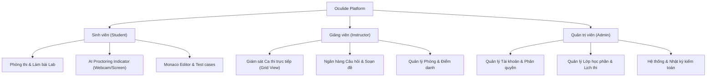

# 🎨 Oculide UI/UX Design System & Role Guidelines

Tài liệu này là chuẩn mực thiết kế giao diện (Design System) của toàn bộ hệ sinh thái **Oculide** (Nền tảng Quản lý Phòng Thực hành Lập trình và Giám sát Thi Trực tuyến ứng dụng AI). 

Tất cả các module mới hoặc các chỉnh sửa giao diện cho **Sinh viên**, **Giảng viên**, và **Quản trị viên** bắt buộc phải tuân theo hướng dẫn này để đảm bảo trải nghiệm người dùng đồng nhất, chuyên nghiệp và chuẩn mực.

---

## 1. Triết lý Thiết kế Cốt lõi (Core Principles)

1. **Academic & Enterprise (Học thuật, Đĩnh đạc & Đáng tin cậy)**: 
   - Không dùng gradient sặc sỡ, màu mè hoạt hình hay emoji cợt nhả trên các bảng biểu dữ liệu.
   - Giao diện phải mang lại cảm giác nghiêm túc của một phòng thi học thuật quốc tế kết hợp tính hiện đại của một phần mềm SaaS cấp doanh nghiệp.
2. **Data-Dense & Legible (Trọng tâm Dữ liệu & Tương phản cao)**:
   - Các bảng dữ liệu cần hiển thị được nhiều thông tin hữu ích nhưng không gây rối mắt.
   - Mã số (Mã sinh viên, Mã phòng thi, Mã đề, Điểm số, IP) **bắt buộc** dùng `font-mono` với `tabular-nums` để các con số thẳng hàng khi so sánh.
3. **No White-on-White / Zero Visual Glitch (Triệt tiêu lỗi chữ trắng trên nền sáng)**:
   - Mọi nút bấm, input, modal hay badge bắt buộc phải kiểm tra độ tương phản ở cả 2 chế độ: **Light Theme** và **Dark Theme**.
   - Tuyệt đối không để xảy ra tình trạng chữ trắng trên nền xám nhạt/trắng.
4. **Card-in-Card Elimination (Tránh lồng viền hộp dày đặc)**:
   - Hạn chế viền xám lồng trong viền xám nhiều cấp. Dùng màu nền nhẹ (`bg-slate-50` hoặc `bg-blue-50/40`) để phân tách khối nội dung con thay vì thêm nhiều lớp border.

---

## 2. Hệ thống Semantic Tokens (Màu sắc & Giao diện)

### A. Bảng màu Nhận diện (Brand & Neutrals)

| Tên Token | Class Tailwind (Light) | Class Tailwind (Dark) | Ứng dụng |
| :--- | :--- | :--- | :--- |
| **Primary Brand** | `bg-blue-600` / `text-blue-600` | `dark:bg-blue-600` / `dark:text-blue-400` | Nút hành động chính (Primary Action), Tab đang chọn, Viền kích hoạt |
| **Primary Hover** | `hover:bg-blue-700` | `dark:hover:bg-blue-500` | Trạng thái hover của nút chính |
| **Brand Subtle** | `bg-blue-50` / `text-blue-700` | `dark:bg-blue-500/15` / `dark:text-blue-300` | Thẻ chọn kích hoạt, Badge trạng thái nhẹ |
| **Surface App** | `bg-[#f8fafc]` hoặc `bg-slate-50` | `dark:bg-[#0b0f17]` | Nền chính toàn bộ trang ứng dụng |
| **Surface Card** | `bg-white` | `dark:bg-[#121824]` | Nền các thẻ Card, Panel, Modal, Dropdown |
| **Surface Subtle** | `bg-slate-50/80` | `dark:bg-white/[0.04]` | Header của bảng dữ liệu, ô Input mặc định |
| **Border Default** | `border-slate-200/90` | `dark:border-white/10` | Đường viền chuẩn cho Card, Bảng, Nút phụ |
| **Border Divider** | `divide-slate-100` | `dark:divide-white/5` | Đường kẻ ngang phân tách các dòng bảng |
| **Text Primary** | `text-slate-900` | `dark:text-slate-100` | Tiêu đề chính, Số liệu KPI, Dữ liệu quan trọng |
| **Text Secondary** | `text-slate-700` | `dark:text-slate-300` | Nội dung văn bản, Tiêu đề cột, Nhãn form |
| **Text Muted** | `text-slate-500` / `text-slate-400` | `dark:text-slate-400` / `dark:text-slate-500` | Chú thích phụ, Metadata, Ngày giờ |

### B. Bảng màu Trạng thái Nghiệp vụ (Semantic Accents)

- **Đang diễn ra / Trực tiếp (Live / Ongoing / Proctoring Alert)**:
  - Nền: `bg-red-50 dark:bg-red-500/15`
  - Viền: `border-red-200 dark:border-red-500/30`
  - Chữ: `text-red-700 dark:text-red-400`
- **Sắp tới / Lên lịch (Scheduled / Upcoming / Lab Practice)**:
  - Nền: `bg-blue-50 dark:bg-blue-500/15`
  - Viền: `border-blue-200 dark:border-blue-500/30`
  - Chữ: `text-blue-700 dark:text-blue-400`
- **Hoàn thành / Hợp lệ (Completed / Active / Valid)**:
  - Nền: `bg-emerald-50 dark:bg-emerald-500/15`
  - Viền: `border-emerald-200 dark:border-emerald-500/30`
  - Chữ: `text-emerald-700 dark:text-emerald-400`
- **Cảnh báo / Tạm khóa / Thiếu thông tin (Warning / Locked / Pending)**:
  - Nền: `bg-amber-50 dark:bg-amber-500/15`
  - Viền: `border-amber-200 dark:border-amber-500/30`
  - Chữ: `text-amber-800 dark:text-amber-300`

---

## 3. Quy chuẩn Typography & Tiếng Việt

1. **Font Stack**:
   - Giao diện chung: `-apple-system, BlinkMacSystemFont, "Segoe UI", Roboto, "Helvetica Neue", Arial, sans-serif`
   - Mã số / Code / Test case / PIN / IP: `ui-monospace, SFMono-Regular, Menlo, Monaco, Consolas, monospace`
2. **Kích thước & Trọng số (Hierarchy Scale)**:
   - **Page Title**: `text-xl sm:text-2xl font-extrabold tracking-tight text-slate-900 dark:text-white`
   - **Section / Card Header**: `text-sm sm:text-base font-bold text-slate-800 dark:text-slate-100`
   - **Body / Table Cell**: `text-xs sm:text-[13px] font-medium text-slate-700 dark:text-slate-300`
   - **Badge / Ký tự phụ**: `text-[10px] sm:text-[11px] font-bold uppercase tracking-wider`
   - **KPI Numbers**: `text-2xl sm:text-3xl font-black text-slate-900 dark:text-white font-mono`
3. **Chống cắt dấu tiếng Việt**:
   - Luôn sử dụng `leading-relaxed` hoặc `leading-normal` cho văn bản tiếng Việt.
   - Tránh dùng `leading-none` trên các thẻ có dấu mũ hoặc dấu ngã/nặng (`ệ`, `ỗ`, `ỹ`) để tránh bị cắt chữ.

---

## 4. Quy chuẩn Kích thước & Điều hướng (Spatial Standards)

1. **Thanh Toolbar / Controls (Chuẩn h-10 và h-11)**:
   - Các nút bấm hành động chính ở đầu trang, ô tìm kiếm (Search Bar), Dropdown bộ lọc phải đồng bộ chiều cao:
     - `h-10` (`40px`): Thanh công cụ chuẩn trong bảng dữ liệu hoặc form cơ bản.
     - `h-11` (`44px`): Thanh công cụ chính của trang (Header Action Bar).
   - Nút hành động phụ trong bảng: `h-8` (`32px`), bo góc `rounded-lg`.
2. **Bo góc (Border Radius)**:
   - Container lớn, Dashboard Card: `rounded-2xl` (`16px`).
   - Button, Input, Modal Dialog: `rounded-xl` (`12px`).
   - Tag, Badge, Icon Wrapper: `rounded-lg` (`8px`) hoặc `rounded-full`.
3. **Sidebar Điều hướng**:
   - Có cơ chế thu gọn / mở rộng nhanh qua phím tắt `Ctrl + B`.
   - Độ rộng mở rộng: `w-[256px]`. Độ rộng thu gọn: `w-[72px]`.

---

## 5. Hướng dẫn UI chuyên biệt theo từng Vai trò (Roles)



---

### 🎓 5.1. Vai trò Sinh viên (Student UI)

*Mục tiêu: Tập trung tối đa, không xao nhãng, chống mỏi mắt, hiển thị thiết bị minh bạch.*

1. **Thanh trạng thái Giám sát AI (AI Proctoring Topbar)**:
   - Đặt cố định ở đỉnh màn hình làm bài thi.
   - Hiển thị rõ ràng 3 trạng thái phần cứng:
     - 📷 **Webcam**: `Live` (Đèn xanh `emerald-500` nhấp nháy) hoặc `Cảnh báo mất tín hiệu` (Màu đỏ `red-500`).
     - 🖥️ **Chia sẻ toàn màn hình**: `Active` (Khóa không cho chuyển tab).
     - ⏱️ **Đồng hồ đếm ngược**: `font-mono text-base font-bold`, đổi sang màu vàng cam khi còn < 10 phút, màu đỏ nhấp nháy khi còn < 3 phút.
2. **Khu vực Viết mã (Monaco Code Editor)**:
   - Tối ưu chế độ Dark Theme (`vs-dark` hoặc `one-dark`) để giảm mỏi mắt khi thi lập trình kéo dài.
   - Thanh chọn ngôn ngữ lập trình (C++, Java, Python) nằm ở góc trên bên phải editor.
   - Nút **"Chạy thử với Test Case"** (Màu slate/viền xám) và nút **"Nộp bài chấm điểm"** (Màu xanh `bg-blue-600 font-bold`).
3. **Bảng Kết quả Test Case (Test Runner Panel)**:
   - Chia 2 tab rõ ràng: `Test case mẫu (Public)` và `Kết quả chạy (Console Output)`.
   - Hiển thị trực quan: `Passed (Màu xanh)` / `Failed (Màu đỏ)` / `Time Limit Exceeded`.
4. **Màn hình Xem Mã Nguồn & Chi tiết Chấm Điểm (`/student/submissions/[id]`)**:
   - Tiêu đề học thuật: `Bài làm [mã_bài] [tên_bài] của [tác_giả]`, hiển thị rõ thời gian nộp và ngôn ngữ biên dịch (`C++20`, `Python 3.11`, `Java 17`).
   - Hỗ trợ 2 chế độ xem song song qua Tabs/Action links:
     - **Xem code**: Khung code có số dòng, syntax highlighting độ tương phản cao, nút sao chép `Copy` ở góc trên, tùy chọn bật/tắt `Xem mã nguồn thô` và nút `Tải mã nguồn`.
     - **Xem kết quả**: Hàng biểu tượng trạng thái trực quan (`✔ ✔ ✔ ✔ ✖`), danh sách Test cases dạng Accordion cho phép mở rộng xem Input, Output kỳ vọng, Output thực tế, phân tích sai lệch (WA/TLE/RTE), và thẻ tổng kết tài nguyên (CPU runtime, RAM usage, Điểm số cuối cùng).
   - Nút **"Nộp lại"** (`bg-blue-600`) cho phép quay lại không gian phòng thi hoặc làm lại bài giải.

---

### 👨‍🏫 5.2. Vai trò Giảng viên (Instructor UI)

*Mục tiêu: Giám sát tức thời, thao tác tạo phòng nhanh, cảnh báo nổi bật.*

1. **Lưới Giám sát Trực tiếp (Live Monitoring Grid View)**:
   - Hiển thị danh sách sinh viên dưới dạng thẻ lưới (Grid 3 hoặc 4 cột).
   - Mỗi thẻ gồm: Ảnh chân dung/webcam tức thời, Mã SV, Tên, Số lần rời màn hình (Tab switch count), và Trạng thái nộp bài.
   - **Hệ thống Cảnh báo Đỏ (Red Flags)**: Nếu sinh viên vi phạm (rời màn hình > 2 lần hoặc phát hiện khuôn mặt thứ hai), viền thẻ tự động chuyển sang màu đỏ rực `ring-2 ring-red-500 bg-red-50/20` và ghim lên đầu danh sách.
2. **Quy trình Tạo phòng thi / Buổi Lab (Multi-step Wizard)**:
   - Thiết kế thành 4 bước rõ ràng với thanh tiến trình (Stepper):
     1. Thông tin ca thi & Môn học
     2. Chọn đề thi từ Ngân hàng câu hỏi
     3. Cấu hình Giám sát AI (Bật/tắt kiểm tra webcam, chia sẻ màn hình)
     4. Danh sách sinh viên & Xuất mã PIN phòng
   - Mỗi bước có nút `Quay lại` và nút `Tiếp tục (h-11)`. Hỗ trợ lưu nháp (`Lưu bản nháp`).
3. **Ngân hàng Câu hỏi & Test Cases Editor**:
   - Trình soạn thảo test case cho phép nhập trực tiếp hoặc tải tệp `.in` / `.out`.
   - Có tùy chọn ẩn/hiển thị test case (`Ẩn khi thi`, `Công khai khi luyện tập`).

---

### 🛡️ 5.3. Vai trò Quản trị viên (Admin UI)

*Mục tiêu: Mật độ dữ liệu cao, bộ lọc mạnh mẽ, xử lý hàng loạt an toàn.*

1. **Bảng dữ liệu Quản trị (Data Tables)**:
   - Header bảng cố định (`sticky top-0 bg-slate-50 dark:bg-white/5`).
   - Hỗ trợ chọn nhiều dòng (Batch Selection) để thực hiện thao tác hàng loạt (Khóa tài khoản, Xuất Excel, Đổi vai trò).
   - Phân trang gọn gàng: Hiển thị rõ `Hiển thị 1 - 25 trên tổng số 1,248 dòng`.
2. **Bộ đọc Nhập tệp Hàng loạt (Bulk Import Modal)**:
   - Phải có bảng **Đối chiếu trường dữ liệu (Field Mapping)**: Hiển thị rõ trường nào trong Excel được map vào trường nào trong bảng User (Mã SV, Họ tên, Lớp, Email).
   - Tự động bỏ qua các cột điểm số, STT, ghi chú của trường đại học mà không gây lỗi.
   - Tự động ghép cột "Họ và tên đệm" + "Tên" của mẫu bảng điểm Việt Nam.
3. **Nhật ký Kiểm toán & Hệ thống (Audit Logs & Terminal View)**:
   - Màn hình log kỹ thuật phải thiết kế dạng Dark Terminal (`bg-[#0a0d14] text-emerald-400 font-mono text-xs`).
   - Có nút lọc theo cấp độ: `INFO (Xanh dương)`, `WARNING (Vàng)`, `ERROR (Đỏ)`, `SECURITY (Tím)`.

---

## 6. Mẫu Code Chuẩn (Reusable Component Patterns)

### A. Nút bấm chuẩn Tương phản (High-Contrast Buttons)

```tsx
// Nút Chính (Primary Action)
<button
  type="button"
  className="h-10 px-4 rounded-xl bg-blue-600 hover:bg-blue-700 active:scale-[0.98] text-xs font-semibold text-white shadow-sm shadow-blue-500/20 transition-all cursor-pointer flex items-center gap-2"
>
  <Plus className="h-4 w-4" />
  <span>Tạo ca thi mới</span>
</button>

// Nút Phụ / Hủy (Secondary / Outline Button) - Đảm bảo KHÔNG lỗi chữ trắng
<button
  type="button"
  className="h-10 px-4 rounded-xl border border-slate-200 dark:border-white/10 bg-white dark:bg-white/5 hover:bg-slate-50 dark:hover:bg-white/10 text-xs font-semibold text-slate-700 dark:text-slate-200 shadow-xs transition-colors cursor-pointer flex items-center gap-2"
>
  <ArrowLeft className="h-4 w-4" />
  <span>Quay lại</span>
</button>

// Nút Cảnh báo / Nguy hiểm (Danger Button)
<button
  type="button"
  className="h-10 px-4 rounded-xl bg-red-600 hover:bg-red-700 text-xs font-semibold text-white shadow-sm shadow-red-500/20 transition-all cursor-pointer flex items-center gap-2"
>
  <Trash2 className="h-4 w-4" />
  <span>Khóa ca thi</span>
</button>
```

### B. Badge Trạng thái Nghiệp vụ chuẩn

```tsx
// Badge Sinh viên (Student Badge)
<span className="inline-flex items-center px-2 py-0.5 rounded-md text-[11px] font-bold bg-blue-50 dark:bg-blue-500/15 text-blue-700 dark:text-blue-300 border border-blue-200/60 dark:border-blue-500/20">
  Sinh viên
</span>

// Badge Đang thi (Live / In Progress Badge)
<span className="inline-flex items-center gap-1.5 px-2.5 py-1 rounded-full text-[11px] font-bold bg-red-50 dark:bg-red-500/15 text-red-700 dark:text-red-400 border border-red-200 dark:border-red-500/30">
  <span className="h-1.5 w-1.5 rounded-full bg-red-600 dark:bg-red-400 animate-pulse" />
  Đang diễn ra
</span>
```

### C. Ô Nhập liệu (Input Field)

```tsx
<div className="space-y-1.5">
  <label className="block text-xs font-semibold text-slate-700 dark:text-slate-300">
    Mã phòng thi <span className="text-red-500">*</span>
  </label>
  <input
    type="text"
    placeholder="VD: LAB-CMU-01"
    className="h-10 w-full rounded-xl border border-slate-200 dark:border-white/10 bg-white dark:bg-white/5 px-3.5 text-xs font-medium text-slate-900 dark:text-slate-100 placeholder:text-slate-400 dark:placeholder:text-slate-500 outline-none transition-all focus:border-blue-500 focus:ring-2 focus:ring-blue-100 dark:focus:ring-blue-500/20"
  />
</div>
```

---

## 7. Checklist Kiểm tra trước khi bàn giao giao diện (UI Quality Gate)

Mỗi khi code xong một giao diện mới hoặc chỉnh sửa màn hình, hãy kiểm tra lần lượt:

- [ ] **Tương phản Dark/Light**: Bật chuyển đổi giữa Dark Mode và Light Mode xem có nút nào bị chữ trắng trên nền trắng không.
- [ ] **Độ cao đồng bộ**: Thanh công cụ và ô tìm kiếm có cùng độ cao `h-10` hoặc `h-11` không.
- [ ] **Font Monospace**: Mã sinh viên, Mã ca thi, PIN, Điểm số đã được bọc class `font-mono` chưa.
- [ ] **Hiển thị tiếng Việt**: Các chữ tiếng Việt có dấu nặng hoặc mũ có bị cắt mép không.
- [ ] **Trạng thái Rỗng (Empty States)**: Khi bảng không có dữ liệu, có hiển thị icon minh họa và nút hướng dẫn thêm mới không.
- [ ] **Không lỗi TypeScript**: Chạy `node frontend/node_modules/typescript/bin/tsc --project frontend/tsconfig.json --noEmit` đạt exit code 0.

